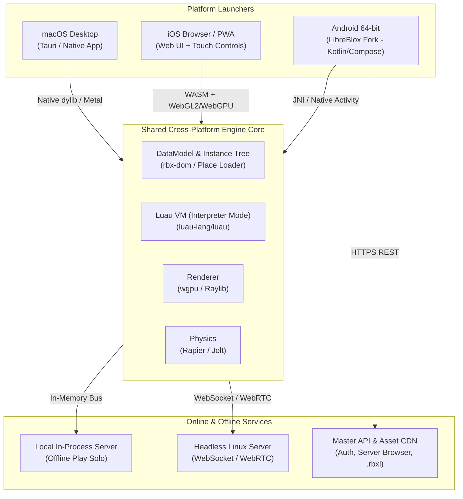

# Cross-Platform Roblox Revival & Launcher — Project Plan

## 1. Vision & Core Requirements

Build a clean-room, open-source Roblox-compatible **revival platform, game engine, and launcher** supporting:

- **Modes:**
  - **Offline ("Play Solo"):** Load local `.rbxl` / `.rbxlx` place files and local/cached assets without an internet connection.
  - **Online Multiplayer:** Browse servers, authenticate, and play on community-hosted authoritative game servers.
- **Target Platforms:**
  - **Android (64-bit `arm64-v8a`):** Native APK/AAB with an adapted [`LibreBlox`](https://github.com/dorfandiysoftware-glitch/LibreBlox) Material 3 launcher UI.
  - **iOS (WebAssembly):** Progressive Web App (PWA) running in Safari with WebGL2/WebGPU rendering, virtual touch controls, and IndexedDB offline storage (no sideloading/JIT required).
  - **macOS:** Universal binary (`arm64` Apple Silicon + `x86_64` Intel) `.app` / `.dmg` with Metal rendering.

> **Why Clean-Room Open Source?**
> Traditional revival launchers (e.g., Novetus, ORRH) wrap archived proprietary Roblox binaries. Those binaries cannot compile to WebAssembly for iOS, lack 64-bit Android (`arm64-v8a`) support on older builds, require Wine/Rosetta workarounds on modern macOS, and carry DMCA risk. A clean-room engine built on open-source components solves all four issues.

---

## 2. System Architecture



---

## 3. Open-Source Building Blocks

| Layer | Recommended Project | License | Role |
| :--- | :--- | :--- | :--- |
| **Android Launcher UI** | [`dorfandiysoftware-glitch/LibreBlox`](https://github.com/dorfandiysoftware-glitch/LibreBlox) | MIT | Fork as the Android `arm64-v8a` launcher; repoint `Api.kt` to our backend & replace `roblox://` in `LaunchActivity.kt` with our native engine activity. |
| **Scripting VM** | [`luau-lang/luau`](https://github.com/luau-lang/luau) | MIT | Official Luau compiler & VM. Built **without** native JIT (`Luau.CodeGen` off) so it runs identically on iOS WASM, Android, and macOS. |
| **Place / Model Parser** | [`rojo-rbx/rbx-dom`](https://github.com/rojo-rbx/rbx-dom) | MIT / MPL-2.0 | Parses `.rbxl`, `.rbxlx`, `.rbxm`, `.rbxmx` and provides Roblox reflection metadata. |
| **Engine Reference (Rust)** | [`chteau/rbx-native`](https://github.com/chteau/rbx-native) | MIT | Reference for `wgpu` + `rbx-dom` + sandboxed Luau rendering and lighting. |
| **Engine Reference (C++)** | [`TornadoCookie/OpenRBLX`](https://github.com/TornadoCookie/OpenRBLX) & [`Luwow-Project/Core`](https://github.com/Luwow-Project) | MIT | References for C/C++ `DataModel`, services, and mobile-first Luau runtime bindings. |
| **Physics** | **Rapier** (Rust) or **Jolt Physics** (C++) | Apache-2.0 / MIT | Deterministic 3D physics with first-class WASM, Android `arm64-v8a`, and macOS support. |
| **macOS & iOS Launcher UI** | **Tauri** (macOS) + **PWA** (iOS) | MIT / Apache-2.0 | Shared web-based launcher UI (Svelte/TypeScript) for browsing servers and managing offline `.rbxl` files. |

---

## 4. Platform-Specific Constraints & Solutions

### A. iOS (WebAssembly)
- **No JIT Allowed:** Safari/WebKit forbids dynamic code generation. Luau must run in **bytecode interpreter mode**.
- **No Raw UDP/TCP Sockets:** Browsers only allow **WebSockets** (`wss://`) and **WebRTC DataChannels**. All online game traffic must support WebSockets so iOS WASM clients can connect without a proxy.
- **Offline Storage:** Store `.rbxl` files and cached assets in **IndexedDB** / **OPFS** (Origin Private File System) via the PWA.
- **Controls:** Render responsive virtual thumbstick + jump/action buttons when touch input is detected.

### B. Android (64-bit `arm64-v8a`)
- **NDK Target:** Compile the shared engine core strictly for `arm64-v8a` (dropping 32-bit `armeabi-v7a` unless needed).
- **LibreBlox Integration:**
  - Keep `Pages.kt`, `Screens.kt`, `Profile.kt`, `Social.kt`, and Material 3 theming.
  - Modify `Api.kt` to fetch from your revival master server (and/or local `.rbxl` directory).
  - Replace `LaunchActivity.kt`'s `roblox://` intent with an Android `SurfaceView` / `NativeActivity` hosting the compiled engine.

### C. macOS
- **Universal Binary:** Compile for both `aarch64-apple-darwin` (Apple Silicon) and `x86_64-apple-darwin` (Intel) using **Metal** (via `wgpu` or SDL3).
- **Launcher:** Package the web launcher + native engine inside a signed/notarized `.app` / `.dmg` (using Tauri or a lightweight native wrapper).

---

## 5. Offline vs. Online Architecture

- **Offline Mode ("Play Solo"):**
  - Single-process execution: the client spawns an in-process authoritative server thread/loop.
  - Asset requests (`rbxassetid://<id>`) resolve against a local asset folder or bundled starter pack (with optional fallback download if online).
- **Online Mode:**
  - **Headless Server Binary:** The exact same engine compiled without graphics/audio, running on Linux VPS/containers.
  - **Network Transport:** WebSocket-based state replication (`Instance` creation, property deltas, `RemoteEvent`, `RemoteFunction`, character position interpolation).
  - **Master Backend (REST + Auth):** User accounts, avatar customization, server list / matchmaking, and `.rbxl` + asset hosting.

---

## 6. Phased Roadmap

### Phase 1: Foundation & Cross-Platform "Hello World"
- [ ] Decide primary engine language: **Rust (`wgpu` + `rbx-dom` + `mlua` + Rapier)** *(recommended for `.rbxl` compatibility)* or **C++ (SDL3/Raylib + `luau` + Jolt)**.
- [ ] Set up monorepo and CI builds for:
  - `macOS` (`arm64` + `x86_64`)
  - `Android` (`arm64-v8a` `.so`)
  - `WASM` (`wasm32` + WebGL2/WebGPU)
- [ ] Embed `Luau` (interpreter mode) and render a basic 3D baseplate + colored `Part`s.

### Phase 2: DataModel, `.rbxl` Loading & Offline Mode
- [ ] Implement core `Instance` hierarchy (`DataModel`, `Workspace`, `Players`, `ReplicatedStorage`, `Lighting`, `RunService`).
- [ ] Load `.rbxl` / `.rbxlx` files via `rbx-dom` (or C++ parser) and spawn parts/scripts.
- [ ] Integrate **Rapier** / **Jolt** physics (`Anchored`, `CanCollide`, `CFrame`, raycasting).
- [ ] Implement basic `Humanoid` movement + camera controller (mouse/keyboard + mobile touch).
- [ ] Add core 2D UI (`ScreenGui`, `Frame`, `TextLabel`, `TextButton`).

### Phase 3: Online Multiplayer & Headless Server
- [ ] Build headless server target (Linux `x86_64` / `arm64`).
- [ ] Implement WebSocket server/client transport + snapshot/delta replication.
- [ ] Implement `RemoteEvent` and `RemoteFunction` between `Script` (server) and `LocalScript` (client).
- [ ] Build Master API (auth, server browser, asset delivery).

### Phase 4: Launchers & Packaging
- [ ] **Android:** Fork `dorfandiysoftware-glitch/LibreBlox`, wire `Api.kt` to Master API + local `.rbxl` picker, and hook `LaunchActivity.kt` to the native `arm64-v8a` engine.
- [ ] **iOS:** Build the PWA launcher shell wrapping the WASM engine with IndexedDB offline `.rbxl` support.
- [ ] **macOS:** Bundle the launcher + native engine into a Universal `.dmg`.

---

## 7. Proposed Repository Layout

```text
/
├── engine/                 # Core cross-platform engine (Rust)
│   └── crates/
│       ├── core/           # DataModel, Instance tree, Luau VM, Rapier physics
│       ├── net/            # WebSocket JSON replication protocol
│       ├── raknet/         # Clean-room 2016 Legacy RCC (RakNet UDP + 0x81..0x97 protocol)
│       ├── server/         # Dual-stack headless server (HTTP/WS :8080 + 2016 RakNet UDP :53640)
│       └── client/         # Cross-platform wgpu client (macOS, Android JNI, WASM)
├── launchers/
│   ├── android-libreblox/  # Forked Kotlin/Compose LibreBlox launcher
│   └── web-pwa/            # Web / iOS PWA launcher shell
└── plan.md                 # This project plan
```

---

## 8. 2016 Legacy RCC Protocol Adapter (`engine/crates/raknet`)

To allow legacy 2016 (and 2012-era) desktop clients to connect to our open-source server without copying proprietary RCC binaries:

- **Transport:** Clean-room RakNet UDP framing (`0x05`/`0x06`/`0x07`/`0x08` offline handshake, `0xC0`/`0xA0` ACK/NAK ranges, `0x84` data datagrams, reliability modes, and MTU split-packet fragmentation/reassembly).
- **2016 Application Handshake:** `ID_CONNECTION_REQUEST` (`0x09`) → `ID_CONNECTION_REQUEST_ACCEPTED` (`0x10`) → `ID_NEW_INCOMING_CONNECTION` (`0x13`) → `ID_PROTOCOL_SYNC` (`0x90`), `ID_SET_GLOBALS` (`0x81`), `ID_PLACEID_VERIFICATION` (`0x92`), `ID_SUBMIT_TICKET` (`0x8A`), `ID_DATA` (`0x83`), `ID_MARKER` (`0x84`), and `ID_CHAT_ALL` (`0x87`).
- **Packet Inspector:** Set `RAKNET_TRACE=1` when running `revival-server` to log Wireshark-style decoded RakNet/2016 packets live.
- **Join Endpoint:** `GET /Game/Join.ashx` exposes the legacy JSON join descriptor pointing to `RAKNET_PORT` (default `53640`).

